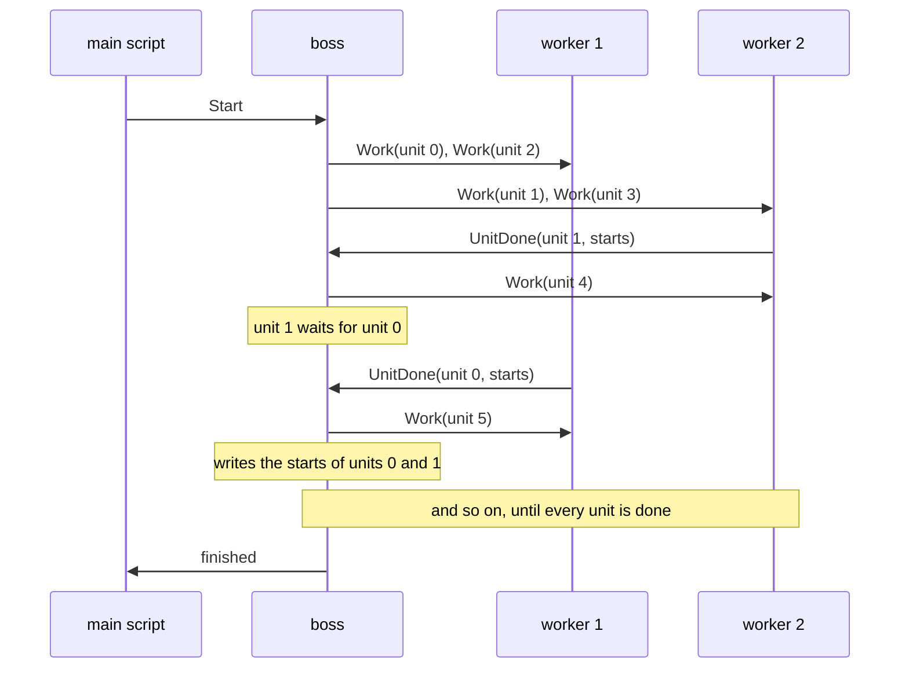

# Sums of consecutive squares in F# with Akka.NET

A single F# script that finds every start s from 1 to N for which s² + (s+1)² + … + (s+k−1)² is a perfect square. A boss actor splits 1..N into work units and gives a worker actor (Akka.NET) a new unit whenever it finishes one; the workers check each start with exact 128-bit integer arithmetic, and the boss prints the starts in ascending order.

Michael Perez started it in September 2021 for a course project (see [Course](#course)), but the repository only ever held an early draft that did not solve the problem. This version was written in 2026: it completes the assignment and runs on .NET 10.

## The problem

Given N and k, print every s ≤ N such that the k consecutive squares starting at s² add up to a square. Two classic examples:

- 3² + 4² = 9 + 16 = 25 = 5², so for k = 2 the start 3 is a solution, and `3 2` prints `3`.
- 1² + 2² + … + 24² = 4900 = 70². Édouard Lucas asked in 1875 for which n a square pyramid of cannonballs, 1² + 2² + … + n², can be rearranged into a square. G. N. Watson proved in 1918 that n = 24 is the only answer besides n = 1. In this program's terms, s = 1 is a solution for k = 24, so `1 24` prints `1`.

For k = 4 there is never a solution. The sum s² + (s+1)² + (s+2)² + (s+3)² = 4s² + 12s + 14 leaves a remainder of 2 when divided by 4, while every square leaves 0 or 1. So `1000000 4` prints nothing.

## How the program works

`SquareSums.fsx` has a boss actor and W worker actors (`--workers`, one per processor by default, but never more than there are units).

- **Work units.** The boss splits 1..N into units of U consecutive starts (`--unit`, 100,000 by default). It gives each worker two units to begin with and another one each time the worker reports a finished unit, so a worker always has its next unit queued and faster workers simply do more units. The unit size is a trade-off: every unit costs two messages and a turn of the boss, so tiny units spend their time on messaging, while units so large that there are only a few per worker leave workers idle at the end. The default of 100,000 starts sits between the two: for k = 24, such a unit takes a worker about 1.7 ms on the desktop in [Results](#results) with 24 workers running, far longer than its two messages take, and N = 10⁹ still makes 10,000 units, over 400 for each of 24 workers. Units of 10⁶ and 10⁷ starts were 0.15 to 0.16 s faster there for N = 10⁹; [Results](#results) compares unit sizes and explains why the default stays at 100,000.
- **Ordered output.** A worker returns the solutions it found in its unit, in ascending order. The boss writes a unit's solutions to stdout as soon as every earlier unit has been written, and units that finish early wait in a dictionary until then. The output is therefore sorted without a final sort, and the program does not keep the starts it has written (unless `--verify` needs them), even when every start is a solution (k = 1).
- **Exact arithmetic.** The sum for start s is S(s) = k·s² + k(k−1)·s + (k−1)k(2k−1)/6. A worker takes the sum just before its unit from this closed form and then slides the window one start at a time: S(s+1) = S(s) + (s+k)² − s² = S(s) + 2ks + k². All sums are unsigned 128-bit integers (`UInt128`), and the program refuses N and k whose largest sum, N² + … + (N+k−1)², does not fit (2¹²⁸ ≈ 3.4·10³⁸). For N = 10⁹ and k = 24 that sum is already 2.4·10¹⁹, too big for 64 bits.
- **Square test.** The last six bits of a square take only 12 of the 64 possible values, so many sums are rejected with one table lookup: half of them for k = 24, and a share that depends on k in general. For the rest, a floating-point square root gives an estimate, and integer arithmetic corrects it to the exact ⌊√S⌋: one Newton step for sums above about 2¹⁰⁴, where the estimate can be off by more than one, then steps of one. S is a square when that root squared equals S, so the answer never rests on a rounded floating-point value.
- **Messages.** The boss sends a worker a `Work` message with the unit's index and its first and last start, and the worker answers with `UnitDone(index, starts, busy)`, where busy is the time the unit took. When every unit is written, the boss completes a task that the main script waits on, and the script shuts the actor system down before it exits. If a worker fails, whether inside a unit or not (the boss supervises the workers), the run ends with an error and exit code 1 instead of waiting for that unit forever.
- **Output.** The starts are written straight to the stdout stream. Everything else that goes to the console, including Akka.NET's own log messages (only warnings and errors, and a normal run has none), is sent to stderr, so stdout carries nothing but the starts.

How the boss keeps two workers busy:



## Running

Requires the [.NET 10 SDK](https://dotnet.microsoft.com/download/dotnet/10.0). The first run downloads Akka.FSharp 1.5.74 from NuGet.

```
dotnet fsi SquareSums.fsx <N> <k> [--workers <w>] [--unit <u>] [--verify] [--stats]
```

| Argument | Meaning |
|---|---|
| `N` | largest start to check; the starts are 1..N |
| `k` | number of consecutive squares in each sum |
| `--workers <w>` | number of worker actors, 1 to 1000 (default: one per processor) |
| `--unit <u>` | starts per work unit (default 100000) |
| `--verify` | check the output independently (see [Verification](#verification)); exit with code 1 if anything is wrong |
| `--stats` | print the number of workers and units, the real time, the CPU time, the CPU/real ratio and the time the workers spent on their units |

Only the starts go to stdout, one per line in ascending order. Statistics, verification results and errors go to stderr, and invalid arguments exit with code 2. The times from `--stats` cover the run from the boss's start to the last unit, not the few seconds that `dotnet fsi` needs to compile the script.

CPU time is the CPU time of the whole process over that interval (`Process.TotalProcessorTime`). It also counts the .NET runtime's own threads: background JIT compilation, and thread-pool threads that spin for a moment while they wait for the next message. So CPU/real overstates the parallelism, especially when messages are frequent: even with a single worker it can come out clearly above 1 (see the last example below). The `workers busy` line adds up the wall-clock time each unit took, so busy/real is the average number of workers computing at once. On an otherwise idle machine it is the better measure of parallelism. On a busy one it also counts the time a worker waited for a processor.

Example, on a laptop with a 6-core Intel Core i7-9750H that was busy with other work at the time ([Results](#results) has timings from an otherwise idle desktop):

```
$ dotnet fsi SquareSums.fsx 3 2
3
$ dotnet fsi SquareSums.fsx 40 24
1
9
20
25
$ dotnet fsi SquareSums.fsx 1000000 4 --stats
10 workers, 10 units of up to 100000 starts
real 0.054 s, CPU 0.131 s, CPU/real 2.43
workers busy 0.083 s, busy/real 1.54
$ dotnet fsi SquareSums.fsx 1000000 2 --verify --stats
3
20
119
696
4059
23660
137903
803760
10 workers, 10 units of up to 100000 starts
real 0.065 s, CPU 0.150 s, CPU/real 2.29
workers busy 0.111 s, busy/real 1.70
verify: OK, 8 starts re-checked with BigInteger arithmetic, and a sequential scan of 1..1000000 finds the same starts
$ dotnet fsi SquareSums.fsx 1000000000 24 --stats 2>&1 | tail -n 5
518925672
816241996
12 workers, 10000 units of up to 100000 starts
real 2.333 s, CPU 21.638 s, CPU/real 9.28
workers busy 26.966 s, busy/real 11.56
$ dotnet fsi SquareSums.fsx 100000000 24 --workers 1 --stats > /dev/null
1 worker, 1000 units of up to 100000 starts
real 1.213 s, CPU 1.648 s, CPU/real 1.36
workers busy 1.141 s, busy/real 0.94
```

[`scripts/measure.sh`](scripts/measure.sh) runs the measurements behind [Results](#results): sweeps of unit sizes and worker counts, the assignment's `1000000 4` run and a few large problems. It records both the `--stats` figures and the time of the whole process, compares each output with a reference answer when one is available, and its settings are described at the top of the script.

## Verification

The expected outputs in [`tests/expected`](tests/expected) (file `<N>_<k>.txt` for N and k) come from [`scripts/reference.py`](scripts/reference.py), which uses Python's exact integers and none of the program's code:

- For N up to 10⁷ it checks every start. It adds up the first window term by term, then slides it along, and tests each sum with `math.isqrt`.
- For k = 24 and larger N it solves a Pell equation instead. With t = 2s + 23 the sum is 6t² + 1150, so s is a solution exactly when y² − 6t² = 1150 has an integer solution y. Multiplying y + t√6 by 5 + 2√6 turns a solution into another one, since 5² − 6·2² = 1, and every solution, or its mirror image (y, −t), follows from one with |t| < 20 in this way. For N up to 10⁷ this gives the same 36 starts as the brute force.

The CI workflow runs the script again and compares its output with the files.

`--verify` checks the run against separate `BigInteger` code:

- Every printed start is checked again with `BigInteger`. The sum is the difference of two square pyramids, (1² + … + (s+k−1)²) − (1² + … + (s−1)²), with 1² + … + m² = m(m+1)(2m+1)/6, and the square root comes from Newton's method on integers. The starts must also be ascending and within 1..N.
- When N ≤ 1,000,000, the same check runs over every start from 1 to N in a single thread, and it must find exactly the printed starts.
- The 128-bit square root and square test are compared with `BigInteger` on squares and their neighbours of every size up to 2¹²⁸ − 1, because only very large N or k produce such sums.

## Results

All figures come from [`scripts/measure.sh`](scripts/measure.sh) on an otherwise idle desktop. Each setting in the sweeps and in `1000000 4` ran three times, the sweeps in three interleaved rounds, and the figures are the means of the three runs; the large problems ran once each. Real time, CPU time, CPU/real and busy/real are the `--stats` figures described in [Running](#running), and the whole process, which also includes compiling the script, was timed separately. Every output matched the expected starts. [`results/measurements.csv`](results/measurements.csv) has every run with all its figures, including the load average before it, which the script's own earlier runs raised.

Machine: Ubuntu 24.04.5 LTS desktop with an AMD Ryzen Threadripper 1920X (12 cores, 24 threads) and 31 GiB of RAM, .NET SDK 10.0.404, Akka.FSharp 1.5.74, default .NET runtime settings ([`results/machine.txt`](results/machine.txt)).

Unit sizes for N = 10⁹ and k = 24, with one worker per processor:

| Starts per unit | Units | Real time | busy/real | CPU/real |
|---:|---:|---:|---:|---:|
| 100 | 10,000,000 | 20.01 s | 0.7 | 8.5 |
| 1,000 | 1,000,000 | 2.55 s | 7.8 | 15.6 |
| 10,000 | 100,000 | 1.09 s | 22.1 | 22.1 |
| 100,000 (default) | 10,000 | 0.77 s | 22.1 | 21.2 |
| 1,000,000 | 1,000 | 0.62 s | 22.0 | 21.0 |
| 10,000,000 | 100 | 0.61 s | 20.4 | 19.6 |
| 100,000,000 | 10 | 0.80 s | 9.2 | 9.2 |

Units of 10⁸ starts make only 10 units, so only 10 workers run. With units of 100 starts, messaging dominates: on average fewer than one worker is computing at a time, yet CPU/real is 8.5.

The best unit size on this desktop was 10⁷ starts, with 10⁶ practically tied; both saved 0.15 to 0.16 s against the default of 10⁵, out of a whole process that takes 3.7 to 3.9 s. The default stays at 10⁵ all the same. Earlier runs on the 6-core laptop of the examples in [Running](#running) found it the fastest there, and larger units spread smaller problems over fewer workers: with units of 10⁷ starts, any N up to 10⁷ is a single unit for a single worker. For N = 10⁹ on a machine like this one, `--unit 1000000` or `--unit 10000000` is the better choice.

Worker counts for N = 10⁹ and k = 24, with units of 10⁷ starts (100 units):

| Workers | Real time | Speedup | busy/real |
|---:|---:|---:|---:|
| 1 | 6.49 s | 1.0 | 1.0 |
| 2 | 3.32 s | 2.0 | 2.0 |
| 4 | 1.75 s | 3.7 | 3.9 |
| 8 | 0.99 s | 6.6 | 7.5 |
| 12 | 0.75 s | 8.7 | 10.7 |
| 16 | 0.71 s | 9.2 | 13.8 |
| 20 | 0.63 s | 10.2 | 17.3 |
| 24 | 0.61 s | 10.6 | 20.3 |

Speedup is the real time with one worker divided by the real time with w workers. It falls further behind busy/real as workers are added because each worker computes more slowly when more of them run: the workers' busy time for the same 10⁹ starts adds up to 6.5 s with one worker, 8.0 s with 12 (as many as there are cores) and 12.4 s with 24 (as many as there are threads). With only about four units per worker at 24 workers, some workers also sit idle while the last units finish, which lowers busy/real and the speedup alike.

`1000000 4`, the run the assignment asked for, prints nothing, as it should (see [The problem](#the-problem)). With units of 10⁷ starts, the best size from the sweep, the whole range is one unit for one worker: real time 0.040 s, CPU time 0.047 s, CPU/real 1.2. With units of 41,667 starts, one for each of the 24 workers: real time 0.039 s, CPU time 0.169 s, CPU/real 4.3. One worker needs only about 10 ms for the whole range, so more workers do not finish sooner. The whole process took 3.2 s either way, nearly all of it spent starting `dotnet fsi`, compiling the script, and starting and stopping the actor system.

Large problems with k = 24, one worker per processor, units of 10⁷ starts and `--verify`, one run each:

| N | Starts found | Real time | busy/real | Whole process |
|---:|---:|---:|---:|---:|
| 10⁹ | 48 | 0.61 s | 20.2 | 3.8 s |
| 10¹⁰ | 54 | 6.03 s | 23.7 | 9.2 s |
| 10¹¹ | 60 | 50.18 s | 24.0 | 53.4 s |

`--verify` passed in each run. N = 10¹¹ is the largest problem solved here: 60 starts in 50 s, with the 24 workers busy nearly all the time.

## Continuous integration

A [GitHub Actions workflow](.github/workflows/ci.yml) runs on every push and pull request:

- `scripts/reference.py` must reproduce every file in `tests/expected`.
- Every case in `tests/expected` runs with `--verify`, and its stdout must match the file. The cases include the empty output of `1000000 4` and N = 10⁹ with k = 24, whose sums need more than 64 bits.
- `1000000 24` runs with 1, 3 and 16 workers and units of 1,000,000, 777 and 1 starts, and the output must not change.
- Invalid arguments must exit with code 2 and print nothing on stdout.

## Course

COP 5615 Distributed Operating System Principles, University of Florida, Fall 2021, taught by Dr. Alin Dobra (Project 1). The assignment was to find every start s ≤ N whose k consecutive squares sum to a perfect square, using the actor model: a boss actor that divides the work into units, and worker actors that process them. The README was to report the work-unit size with the best performance and how it was found, the output of `1000000 4`, the real time, CPU time and CPU/real ratio of that run, and the largest problem solved.

## Author

Michael Perez ([michaelperez023](https://github.com/michaelperez023))

## References

- Édouard Lucas, Question 1180, *Nouvelles Annales de Mathématiques*, 2nd series, 14 (1875), p. 336.
- G. N. Watson, "The problem of the square pyramid", *Messenger of Mathematics* 48 (1918), 1–22.
- The sums 1² + 2² + … + n² are the square pyramidal numbers, [OEIS A000330](https://oeis.org/A000330).
